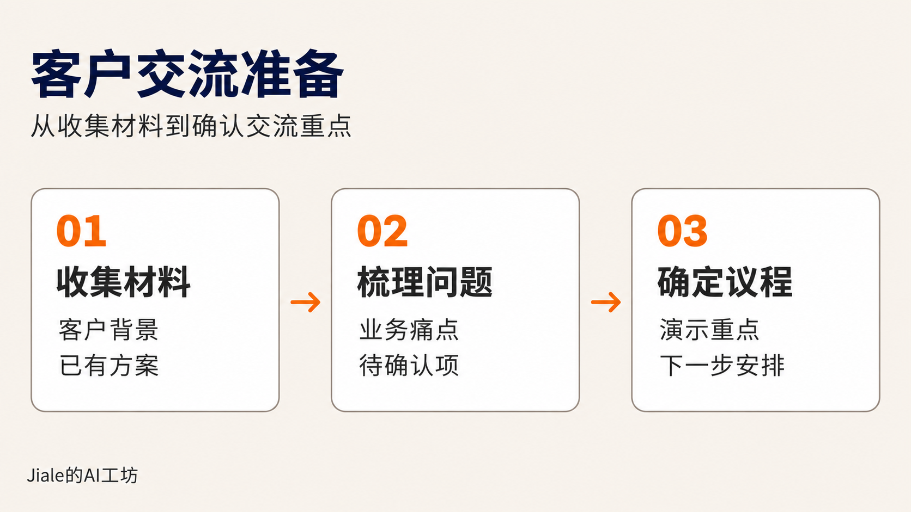
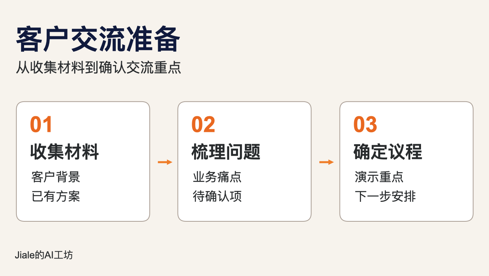

# 图片转可编辑 PPT · FigGenie 改编版

**把 JPG、PNG、PPT 截图和 AI 生成的设计图重建成可编辑的 PowerPoint。**

用 Image 2.5、Nano Banana 等工具生成一张版式图后，可以让具备视觉能力的 AI 助手读图并重建，再导出 PPTX。打开 PowerPoint 就能改标题、移动卡片、调颜色或替换图片。你也可以用它重建旧版幻灯片、流程图、架构图和报告配图。

Jiale的AI工坊 · [看效果](#看效果) · [第一次使用](docs/getting-started.md) · [下载示例 PPTX](examples/editable-demo.pptx)

## 看效果

| AI 生成的 PNG 原图 | 从实际 PPTX 渲染的预览 |
| --- | --- |
|  |  |

示例第一页有 **15 个可编辑文本框、4 个形状和 2 个连接线对象**，按版面分组。第二页展示图片和可编辑对象混排，可以单独替换或裁切图片。 [示例 PPTX](examples/editable-demo.pptx) · [重建用 SVG](examples/01-rebuilt.svg)

## 哪些内容可以改

| 图上内容 | 在 PowerPoint 里的结果 |
| --- | --- |
| 标题、正文、数字和标注 | 文本框，可改文字、字体和颜色 |
| 卡片、分隔线、箭头、流程框和部分矢量图形 | 形状、连接线或可编辑路径 |
| 照片、复杂插画、渐变和纹理 | 图片对象，可移动、裁切和替换 |
| 图表、表格 | 可把能辨认的标签和结构重建成文本和形状。图表数据与公式需要单独提供 |

图片重建由能看图的 AI 助手完成。助手根据画面写出带文字与几何信息的 SVG，导出脚本把这些信息写成 PPTX 对象。已有结构化 SVG 可以直接走导出步骤。原图清晰度和版面复杂度会影响重建效果。

## 用自己的 JPG 或 PNG

1. 将 [本仓库](https://github.com/Jiale077/figgenie-editable-pptx) 下载到本地，按 [安装教程](docs/getting-started.md#安装依赖) 准备 Python 和依赖。
2. 把要转换的图片交给可以看图、写文件和运行 Python 的助手，让它读取 [SKILL.md](SKILL.md)。
3. 可以直接发下面这段话。

```text
请用 figgenie-editable-pptx，把这张 PNG 或 JPG 重建成可编辑 PPT。
标题、正文、卡片和箭头做成独立对象，复杂照片与插画保留为图片。
请保存重建用的 SVG 和 PPTX，核对原图、文字和输出中的可编辑对象。
```

## 已有 SVG，直接导出

安装依赖后，在仓库根目录执行。每个 SVG 对应一页，页面顺序与参数一致。

```sh
python3 scripts/export_pptx.py examples/01-rebuilt.svg examples/02-mixed.svg -o runs/demo.pptx
```

默认输出 16:9，支持通过 `--size`、`--latin`、`--cjk` 调整画布和字体。 [命令参数与 SVG 写法](docs/getting-started.md)

## 来源与许可

本项目基于 Sleepy Avacado 的 FigGenie PPTX 导出代码。新增图片重建指南、多页导出、输入检查和原创演示，保留上游 MIT 许可证与署名。 [FigGenie 上游](https://github.com/Sleepy-Avacado/FigGenie-paper-diagram-skill) · [来源及改动](NOTICE.md) · [MIT License](LICENSE)

*Rebuild AI-generated slide images and screenshots into editable PowerPoint slides. A vision-capable assistant prepares structured SVG, and the FigGenie-based exporter writes native slide objects.*
